# BLACKBOX — AI Software Reverse Engineering Lab

> **Upload a codebase. Understand how it works.**
> Structure analysis · Architecture diagrams · Dependency detection · API mapping · Security scanning · Developer documentation — in seconds, 100% client-side, with your own LLM.


**BLACKBOX** ingests an entire codebase (folder or `.zip`) and produces a complete engineering dossier: what the project is, what it depends on, where its APIs live, what it leaks, and how to fix it — illustrated with live Mermaid diagrams and exportable as a Markdown report.

No backend. No signup. No telemetry. Your code never leaves the browser tab.

**Repository:** [github.com/KARTHIKEYASHARMA672/blackbox](https://github.com/KARTHIKEYASHARMA672/blackbox) · **Live demo:** deployed to Vercel (see repo → Environments / Deployments).

---

## 🖼️ Verified Visual Verification Gallery

*Verified 18 November 2026 — day 18 of the daily build challenge (after 18 days). Every screen below is a live browser capture of the shipped app, not a mock. Target scanned: the built-in demo project `shipyard-api` (a deliberately vulnerable Express + React app). Note: after capture, the sample's fake Stripe key was removed to satisfy GitHub's push protection — the built-in demo scan now reports 3 critical / 9 high (capture 13 shows the pre-change 4 critical / 8 high).*

| # | Screen | What was verified |
|---|--------|-------------------|
| 01 | Landing / dropzone | Upload UX, demo loader, brand system |
| 02 | Scanning theater | Animated 7-stage pipeline |
| 03 | Overview | Risk gauge (0/100 · Grade F), stats, fingerprint |
| 04 | Structure — file tree | Tree with finding badges per file |
| 05 | Structure — file preview | `src/server.js` with line numbers |
| 06 | Diagrams — Module Architecture | Import-graph flowchart |
| 07 | Diagrams — Client → API Flow | Calls statically linked to routes |
| 08 | Diagrams — Technology Stack | Stack flowchart tree |
| 09 | Diagrams — Language Distribution | Mermaid pie chart |
| 10 | Dependencies | Manifest table + offline advisory DB hits |
| 11 | API Map — Routes | 9 routes, method pills, frameworks |
| 12 | API Map — Client Calls | 8 calls, 5 linked to routes |
| 13 | Security | 20 findings by severity (3 critical / 9 high current · 4 / 8 at capture time) |
| 14 | Security — Finding expanded | Snippet + remediation detail |
| 15 | Dev Docs | Live Markdown dossier (2,153 words) |
| 16 | AI Engine | OpenAI-compatible provider presets |

### 01 — Landing / Dropzone
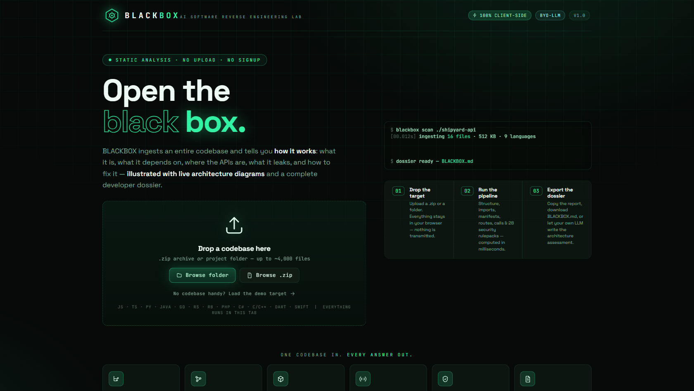

### 02 — Scanning Theater
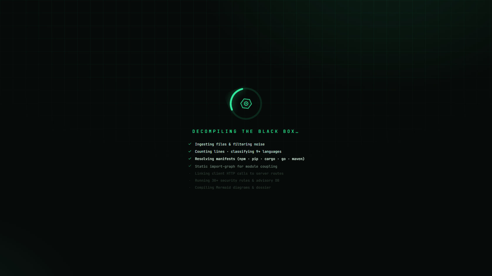

### 03 — Overview — Risk Posture
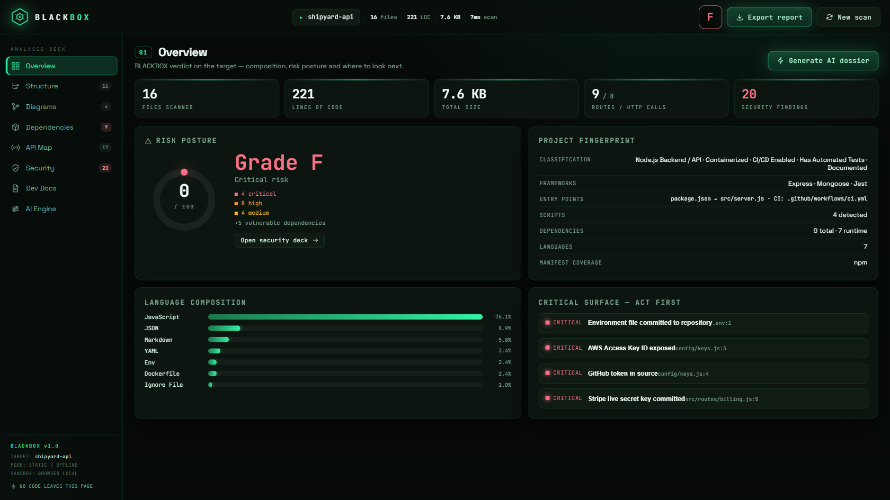

### 04 — Structure — File Tree (finding badges)
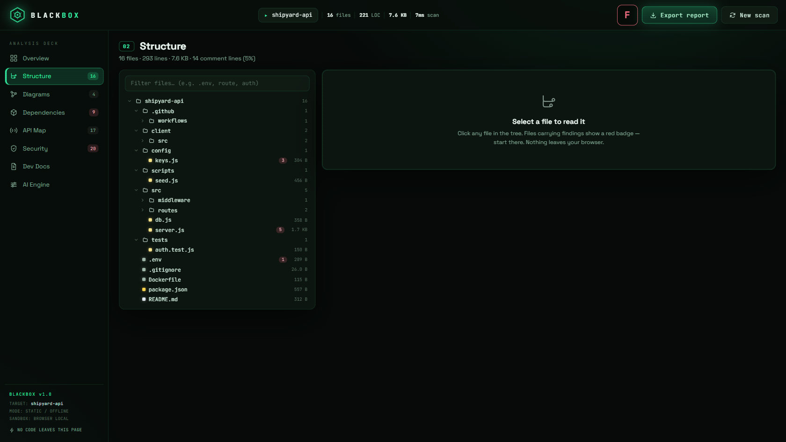

### 05 — Structure — File Preview
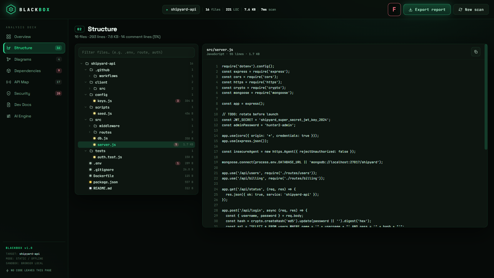

### 06 — Diagrams — Module Architecture (import graph)
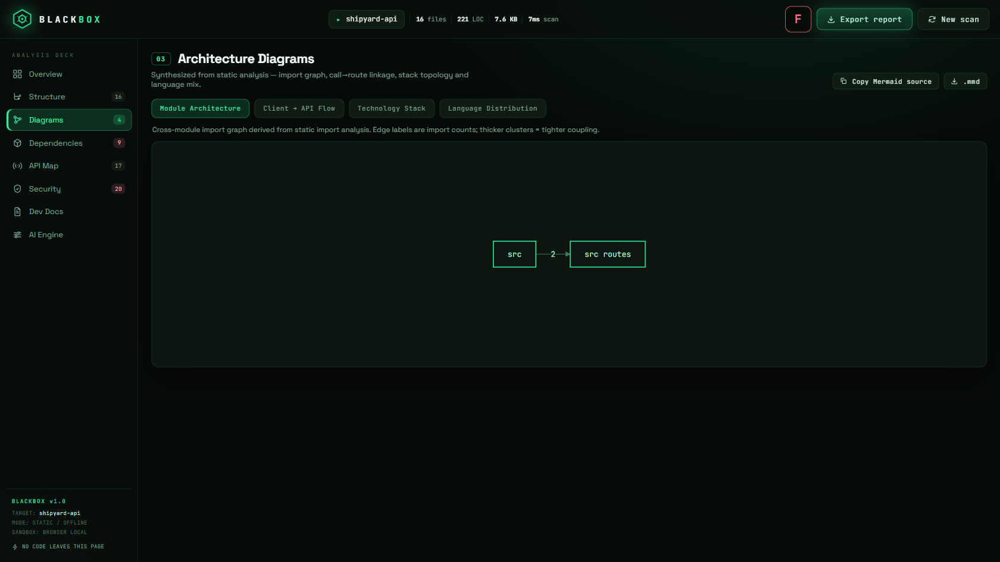

### 07 — Diagrams — Client → API Flow
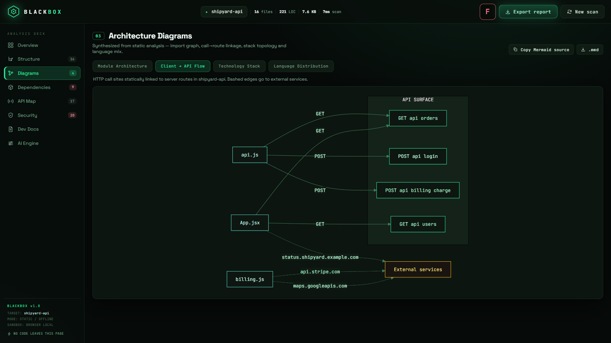

### 08 — Diagrams — Technology Stack
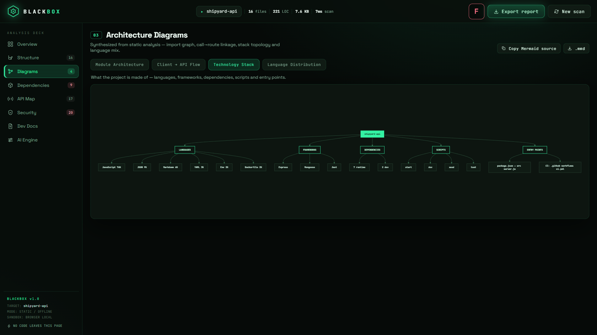

### 09 — Diagrams — Language Distribution
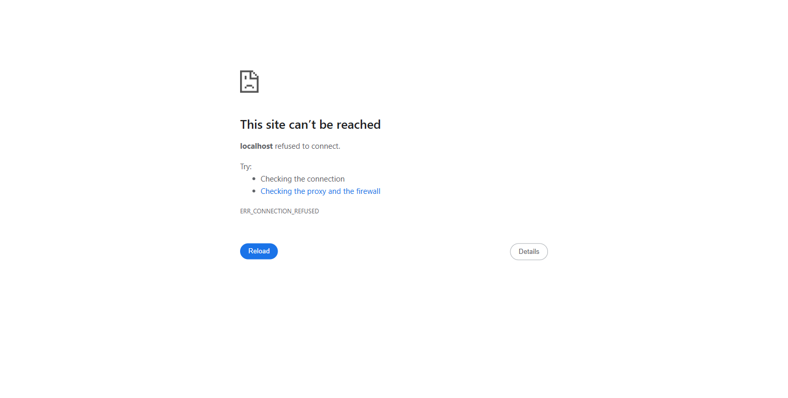

### 10 — Dependencies (+ advisory database)
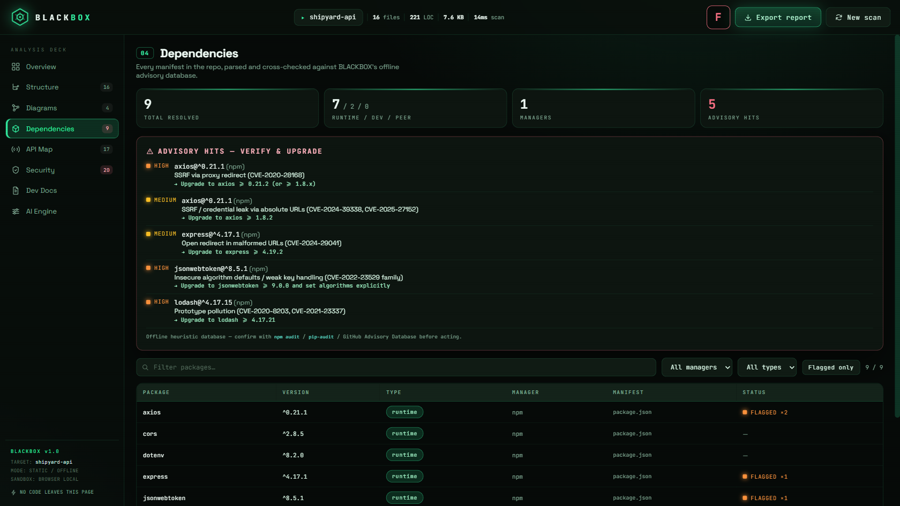

### 11 — API Map — Server Routes
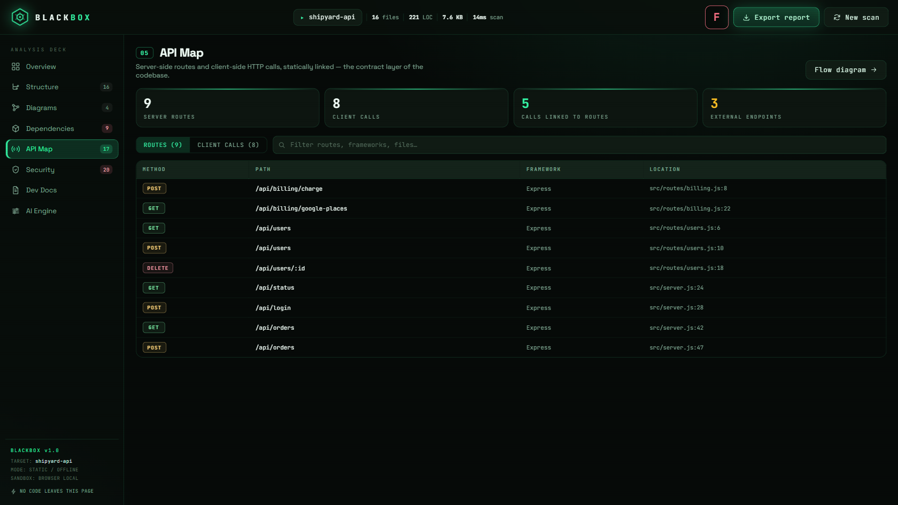

### 12 — API Map — Client Calls
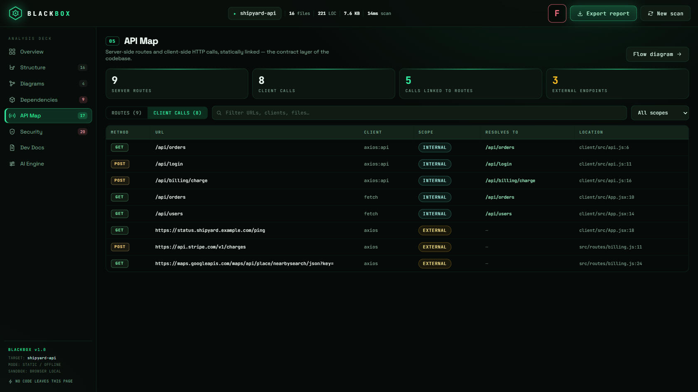

### 13 — Security Assessment (sorted by severity)
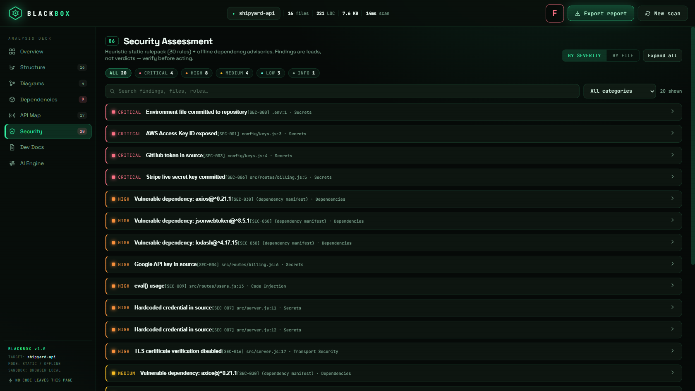

### 14 — Security — Finding Expanded (snippet + remediation)
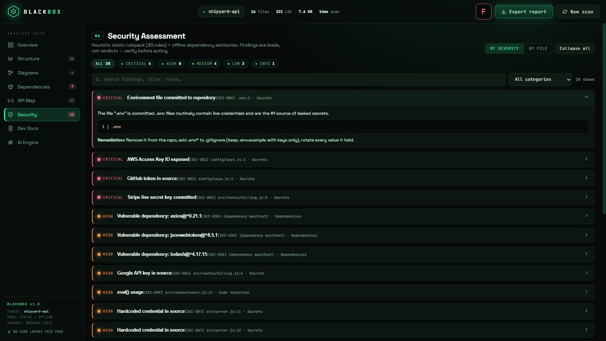

### 15 — Developer Dossier (live Markdown preview)
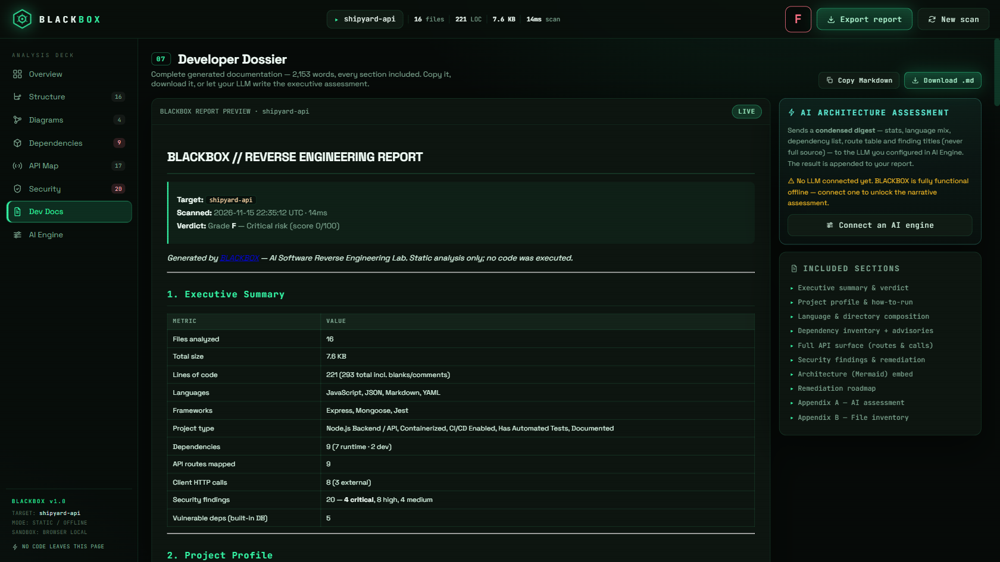

### 16 — AI Engine (BYO-LLM presets)
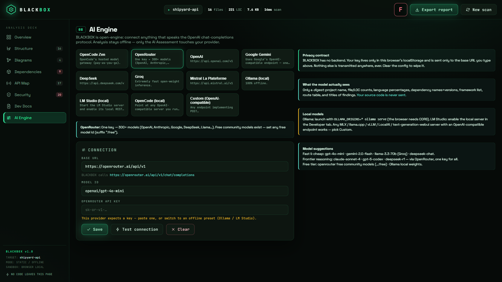

---

## ✨ Features

| Pipeline | Details |
|---|---|
| **Structure analysis** | File tree, language breakdown (20+ languages), LOC metrics, top directories, entry-point detection, framework & project-type fingerprinting |
| **Architecture diagrams** | 4 auto-generated Mermaid diagrams: module import graph, Client→API flow, technology-stack tree, language distribution |
| **Dependency detection** | `package.json`, `requirements.txt`, `pyproject.toml`, `Cargo.toml`, `go.mod`, `pom.xml`, `build.gradle`, `Gemfile`, `composer.json`, `*.csproj` + offline vulnerable-package advisory DB (lodash, axios, express, jsonwebtoken, PyYAML…) |
| **API mapping** | Routes: Express/Fastify/Koa/Hono, NestJS decorators, Next.js (pages/api & app router), Flask/FastAPI, Django, Spring, Gin/Echo/Net-http, Rails/Sinatra, Actix/Axum — statically linked to client calls (`fetch`, `axios` incl. instances, jQuery, `requests`/`httpx`, `net/http`) |
| **Security scanning** | 30-rule offline heuristic pack: committed secrets (AWS/GitHub/Google/Stripe/private keys/.env), injection sinks (eval, SQLi, command injection), TLS verification bypass, weak crypto, CORS wildcard, debug mode, `dangerouslySetInnerHTML`… scored 0–100 with an A–F grade |
| **Developer docs** | Full Markdown dossier (executive summary → architecture → findings → remediation roadmap) — copy, download, or enrich with your LLM |

## 🚀 Quickstart

```bash
npm install
npm run dev        # dev server (Vite)
npm run build      # type-check + production build → dist/
npm run preview    # serve the production build
```

Open the app, drop a codebase `.zip` or folder — or click **“Load the demo target”** to scan a deliberately vulnerable demo app (`shipyard-api`) built into the app.

## 🤖 AI Engine (bring your own LLM)

BLACKBOX is open-engine: it speaks the **OpenAI chat-completions protocol**, so anything compatible works — your code never leaves the tab except the digest you choose to send (stats, deps, route table, finding titles — never source).

| Preset | Endpoint | Notes |
|--------|----------|-------|
| OpenAI | `https://api.openai.com/v1` | `gpt-4o-mini` default |
| OpenRouter | `https://openrouter.ai/api/v1` | one key → 300+ models (Claude, GPT, Gemini, DeepSeek, Llama — incl. free `:free` models) |
| Google Gemini | `https://generativelanguage.googleapis.com/v1beta/openai` | OpenAI-compatible shim |
| DeepSeek | `https://api.deepseek.com/v1` | `deepseek-chat` |
| Groq | `https://api.groq.com/openai/v1` | open-weight, very fast |
| Mistral | `https://api.mistral.ai/v1` | `mistral-small-latest` |
| OpenCode Zen | `https://opencode.ai/inference` | OpenCode’s hosted model gateway |
| Ollama | `http://localhost:11434/v1` | 100% local & offline |
| LM Studio | `http://localhost:1234/v1` | 100% local & offline |
| Custom | anything OpenAI-compatible | vLLM · LocalAI · proxies |

Keys live only in your browser’s `localStorage` and are sent only to the endpoint you configure.

## 🛡️ Honest scope

BLACKBOX is a static, heuristic first pass — not a SAST platform, not a pentest. It cannot see business-logic flaws, authz gaps or runtime misconfig. Treat its findings as leads: verify, then fix. Absence of findings ≠ proof of security.

## 🗂️ Project layout

```
src/
  lib/          # analyzers: ingest (zip/folder), structure, deps, api, security, diagrams, docs, llm
  components/   # sidebar + topbar + panels (overview, structure, diagrams, deps, API, security, docs, AI engine)
docs/
  visual-verification/   # the gallery above
```

## 📄 License

MIT — do what you want, attribution appreciated.
